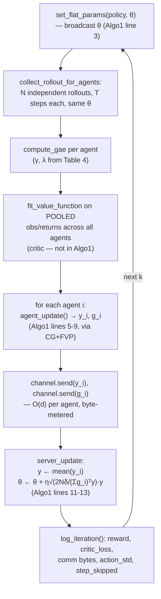

# FedNPG-ADMM: Theory and Implementation, End to End

This document explains, from first principles, everything behind this repo's one fully-built
training path (`fednpg_admm`): the reinforcement-learning theory it rests on (policy gradients,
natural policy gradient, TRPO, GAE), the federated-learning problem the paper solves (FedNPG's
$O(d^2)$ communication bottleneck), the ADMM reformulation that fixes it, and — line by line — how
every one of those mathematical objects is actually implemented in this codebase.

It is written to stand on its own: you shouldn't need to have this repo's training results open
to follow it. Every equation is transcribed from the paper (Lan et al., *"Improved Communication
Efficiency in Federated Natural Policy Gradient via ADMM-based Gradient Updates,"* NeurIPS 2023,
[arXiv:2310.19807](https://arxiv.org/abs/2310.19807), PDF at repo root), and every code reference
points at a real `file:line` in this repo as of this writing.

## Table of contents

**Part I — Theory**
1. [The RL problem: MDPs, returns, and the policy gradient](#1-the-rl-problem-mdps-returns-and-the-policy-gradient)
2. [Why plain gradient ascent on θ is a bad idea](#2-why-plain-gradient-ascent-on-θ-is-a-bad-idea)
3. [The Fisher information matrix and the natural gradient](#3-the-fisher-information-matrix-and-the-natural-gradient)
4. [From natural gradient to a trust region: NPG's closed form](#4-from-natural-gradient-to-a-trust-region-npgs-closed-form)
5. [Generalized Advantage Estimation (GAE)](#5-generalized-advantage-estimation-gae)
6. [Going federated: FedNPG and its O(d²) bottleneck](#6-going-federated-fednpg-and-its-od²-bottleneck)
7. [FedNPG-ADMM: turning the global NPG solve into a consensus problem](#7-fednpg-admm-turning-the-global-npg-solve-into-a-consensus-problem)
8. [Algorithm 1, line by line](#8-algorithm-1-line-by-line)
9. [What the convergence proof actually promises](#9-what-the-convergence-proof-actually-promises)

**Part II — This repo's implementation**
10. [Package map and the flat-parameter convention](#10-package-map-and-the-flat-parameter-convention)
11. [The policy network, and what "exploration collapse" means](#11-the-policy-network-and-what-exploration-collapse-means)
12. [Rollout collection: `collector.py` and `RolloutBatch`](#12-rollout-collection-collectorpy-and-rolloutbatch)
13. [GAE in code: `gae.py`](#13-gae-in-code-gaepy)
14. [The critic: pooled fitting, a design choice not in the paper](#14-the-critic-pooled-fitting-a-design-choice-not-in-the-paper)
15. [The local ADMM solve: `agent.py`](#15-the-local-admm-solve-agentpy)
16. [Fisher-vector products without ever forming the matrix: `fisher.py`](#16-fisher-vector-products-without-ever-forming-the-matrix-fisherpy)
17. [Conjugate gradient: `cg.py`](#17-conjugate-gradient-cgpy)
18. [The server update and the trust-region step size: `server.py`](#18-the-server-update-and-the-trust-region-step-size-serverpy)
19. [The communication channel and byte accounting](#19-the-communication-channel-and-byte-accounting)
20. [`train.py`: the full per-iteration loop, tied together](#20-trainpy-the-full-per-iteration-loop-tied-together)
21. [Results schema, hyperparameters, and device resolution](#21-results-schema-hyperparameters-and-device-resolution)

**[Appendix: symbol ↔ code quick-reference table](#appendix-symbol--code-quick-reference-table)**

---

# Part I — Theory

## 1. The RL problem: MDPs, returns, and the policy gradient

An MDP is a tuple $\langle S, A, P, R, \gamma \rangle$: state space, action space, transition kernel, reward
function, and discount factor $\gamma \in (0,1)$. A policy $\pi$ maps states to a distribution over
actions. The object everyone cares about is the **state value function**

$$
V_\pi(s) = \mathbb{E}\left[ \sum_{t=0}^{\infty} \gamma^t r(s_t, a_t) \mid s_0 = s \right]
$$

(expectation over $a_t \sim \pi(\cdot|s_t)$, $s_{t+1} \sim P(\cdot|s_t,a_t)$) — the expected discounted return
starting from $s$. The **Q-function** $Q_\pi(s,a)$ is the same thing but conditioned on taking
action $a$ first. The **advantage** $A_\pi(s,a) = Q_\pi(s,a) - V_\pi(s)$ measures how much better
action $a$ is than "whatever $\pi$ would have done anyway" at state $s$ — it's a *centered* signal,
which matters a lot for the variance of what follows.

With continuous states, the policy is parameterized by $\theta \in \mathbb{R}^d$ (a neural network in our case),
written $\pi_\theta$. The training objective is

$$
J(\theta) = \mathbb{E}_{s \sim \rho}\big[V_{\pi_\theta}(s)\big] \qquad \text{(paper eq. 4)}
$$

— expected value under some starting-state distribution $\rho$. The **policy gradient theorem**
(Sutton et al.) gives a closed form for $\nabla_\theta J(\theta)$ that doesn't require differentiating through
the environment's (unknown, non-differentiable) dynamics:

$$
\nabla_\theta J(\theta) = \mathbb{E}_\tau\Big[ \sum_t \big(\nabla_\theta \log \pi_\theta(a_t|s_t)\big) \cdot A_{\pi_\theta}(s_t,a_t) \Big] \qquad \text{(paper eq. 5)}
$$

This is the **score-function estimator**: sample trajectories, weight each action's log-probability
gradient by its advantage, average. It's called $g$ in the paper and in this repo. Two things to
notice, because they resurface constantly later:

- The advantage $A$ must be treated as a *fixed number* here, not a function of $\theta$ you
  differentiate through — it comes from a separately-fit critic, evaluated at the current policy,
  then frozen (**detached**, in PyTorch terms) before it's multiplied into the log-prob gradient.
  Differentiating through it too would silently change what this gradient means.
- This whole equation only tells you a *direction* to improve $\theta$ in, infinitesimally. It says
  nothing about how far to step.

## 2. Why plain gradient ascent on θ is a bad idea

The naive update $\theta \leftarrow \theta + \alpha \cdot g$ treats every coordinate of $\theta$ as equally "sized" — it's steepest
ascent under the ordinary Euclidean metric $\|\Delta\theta\|_2$. But $\theta$ is just the internal weights of a
neural network that happens to parameterize a probability distribution $\pi_\theta(a|s)$. There is no
reason a fixed-size step in weight-space corresponds to a fixed-size *change in the actual
policy's behavior*: a tiny weight change in one layer might barely move the output distribution,
while an equally tiny change elsewhere might blow it up completely (e.g. if it feeds into a
softmax's logits or, here, the log-std of a Gaussian). Vanilla policy gradient is **not invariant
to reparameterization** — rescale or reparameterize the network and the "same" step size now
means something completely different in policy space. This causes the well-known instability of
vanilla PG: steps that are too small in flat directions (slow learning) and too large in steep
ones (policy collapse/divergence) at the same time.

The fix is to measure distance not in weight-space, but in **distribution space** — how different
is $\pi_{\theta+\Delta\theta}$ from $\pi_\theta$, *as distributions*, regardless of how that difference happens to be
encoded in the weights.

## 3. The Fisher information matrix and the natural gradient

The local, second-order approximation of KL-divergence between two nearby distributions in the
same parametric family is exactly the **Fisher information matrix**:

$$
KL(\pi_\theta \,\|\, \pi_{\theta+\Delta\theta}) \approx \tfrac{1}{2} \Delta\theta^\top F(\theta) \Delta\theta, \qquad F(\theta) = \mathbb{E}_{s,a \sim \pi_\theta}\big[\nabla \log \pi_\theta(a|s)\, \nabla \log \pi_\theta(a|s)^\top\big]
$$

$F(\theta)$ is exactly the thing Assumption 4.2 in the paper requires to be positive definite
($F(\theta) \succeq \mu_F \cdot I$) — it defines a local Riemannian metric on the space of policies. The **natural
gradient** is the steepest-ascent direction under *this* metric instead of the Euclidean one:

$$
\text{natural gradient} = F(\theta)^{-1} g
$$

Rescaling/reparameterizing the network changes both $g$ and $F$ in a way that exactly cancels out
in the product $F^{-1}g$ — that's the whole point: it's the one gradient direction that doesn't
depend on the arbitrary choice of how the policy happens to be parameterized.

## 4. From natural gradient to a trust region: NPG's closed form

NPG (Kakade 2001) formalizes "take a natural-gradient step, but stay within a trust region of
policy-space where the linearized-KL approximation above is trustworthy":

$$
\begin{aligned}
\theta^{k+1} &= \arg\max_\theta \ \ \mathbb{E}_{s,a}\Big[ \frac{\pi_\theta(a|s)}{\pi_{\theta^k}(a|s)} \cdot A_{\pi_{\theta^k}}(s,a) \Big] \\
\text{s.t.} \quad & \bar{D}(\theta \,\|\, \theta^k) \le \delta
\end{aligned}
\qquad \text{(paper eq. 6-7)}
$$

where $\bar{D}(\theta\|\theta^k) = \mathbb{E}_s\big[D(\pi_\theta(\cdot|s)\,\|\,\pi_{\theta^k}(\cdot|s))\big]$ is the average KL divergence and $\delta$ is the
trust-region radius. First-order Taylor-expanding the objective and second-order expanding the KL
constraint around $\theta^k$ turns this into a quadratic program:

$$
\begin{aligned}
\theta^{k+1} &= \arg\max_\theta \ \ g^\top(\theta - \theta^k) \\
\text{s.t.} \quad & \tfrac{1}{2}(\theta-\theta^k)^\top H (\theta-\theta^k) \le \delta
\end{aligned}
\qquad \text{(paper eq. 8)}
$$

where $H = \nabla^2_\theta \bar{D}(\theta\|\theta^k) \in \mathbb{R}^{d\times d}$ is the Fisher information matrix (this is *why* the Hessian
of KL equals Fisher information — see §16). Solving this constrained QP via Lagrangian duality
gives NPG's famous closed-form update:

$$
\theta^{k+1} = \theta^k + \sqrt{\frac{2\delta}{g^\top H^{-1} g}} \cdot H^{-1}g \qquad \text{(paper eq. 9)}
$$

Two pieces worth separating mentally, because the rest of this document keeps referring back to
them independently:

1. **Direction**: $H^{-1}g$ — the natural gradient, requiring one linear solve against the Fisher
   matrix.
2. **Step size**: $\sqrt{\frac{2\delta}{g^\top H^{-1}g}}$ — chosen so that the step, measured in the *KL/Fisher metric*
   (not Euclidean weight-space), has size exactly $\delta$. This is a closed-form trust-region radius,
   not a tunable learning rate — it automatically shrinks the step when $H^{-1}g$ is "large" in the
   Fisher metric, and grows it when the natural gradient is small, always landing at the same KL
   budget $\delta$.

**TRPO** (Schulman et al. 2015) is the "practical version" of exactly this: same direction and
step-size math, plus a backtracking line search on the *actual* (non-linearized) surrogate
objective and KL constraint, to guard against the Taylor approximations breaking down for large
steps. TRPO also popularized solving for $H^{-1}g$ via **conjugate gradient against Hessian-vector
products**, rather than ever forming $H$ — that's the exact numerical trick this repo's `cg.py`/
`fisher.py` implement (§16-17), inherited from TRPO even though NPG itself doesn't mandate any
particular linear-solve method.

## 5. Generalized Advantage Estimation (GAE)

Nothing above says how to *get* $A_{\pi_\theta}(s,a)$ in practice — it's a theoretical quantity, not
something you observe directly from one rollout. GAE (Schulman et al. 2016, cited in the paper's
Setup section as the basis for its $\lambda=0.95$) is the standard practical estimator, trading off bias
against variance with one parameter $\lambda \in [0,1]$:

$$
\begin{aligned}
\delta_t &= r_t + \gamma \cdot V(s_{t+1}) - V(s_t) &&\text{(one-step TD residual, using a fitted critic } V\text{)} \\
A_t^{\text{GAE}} &= \sum_{l=0}^{\infty} (\gamma\lambda)^l \cdot \delta_{t+l} &&\text{(exponentially-weighted sum of TD residuals)}
\end{aligned}
$$

$\lambda=0$ gives the low-variance/high-bias one-step TD advantage; $\lambda=1$ gives the high-variance/
low-bias full Monte-Carlo advantage (minus a baseline). $0.95$ is a standard middle ground. This
requires a **critic** $V(s)$ — a separate function approximator, fit by regression toward observed
returns — which is *not* part of Algorithm 1 at all (see §14 for how this repo trains one anyway).

## 6. Going federated: FedNPG and its O(d²) bottleneck

**FedNPG**: $N$ agents collaboratively train one shared global policy $\theta$, without sharing raw
trajectory data. One iteration (Figure 1(a) in the paper):

1. **Downlink**: server broadcasts current $\theta$ to all $N$ agents.
2. **Uplink**: each agent $i$ collects its own local data $D_i$ under the shared $\pi_\theta$, then
   computes its own local gradient $g_i$ **and its own local Fisher/Hessian matrix $H_i \in \mathbb{R}^{d\times d}$**,
   and sends *both* to the server.
3. **Global update**: server averages, $H \leftarrow \frac{1}{N}\sum_i H_i$, $g \leftarrow \frac{1}{N}\sum_i g_i$, then takes the exact
   NPG step from eq. 9 using the averaged matrix and gradient:

$$
\theta \leftarrow \theta + \sqrt{\frac{2\delta}{g^\top H^{-1} g}} \cdot H^{-1}g \qquad \text{(paper eq. 11)}
$$

**The bottleneck**: $H_i$ is a $d \times d$ matrix. Sending it every round costs $O(d^2)$ per agent, per
iteration — for a network with, say, 700K parameters (this repo's Humanoid policy), that's ~5×10¹¹
elements *per agent, per iteration*. The paper's Table 1 quantifies exactly this: FedNPG's
communication complexity is $O(d^2/((1-\gamma)^6 N \epsilon^2))$, vs. plain (non-federated, non-second-order) NPG's
sample complexity of $O(1/((1-\gamma)^6 \epsilon^2))$ for comparison — the $d^2$ factor is the whole problem this
paper exists to remove.

## 7. FedNPG-ADMM: turning the global NPG solve into a consensus problem

The key observation: the *quantity every agent actually needs the server to compute* is just the
vector $\big(\sum_i H_i\big)^{-1} \sum_i g_i$ — nobody needs $H_i$ itself for anything else. And that vector is exactly
the minimizer of a quadratic:

$$
\Big(\sum_i H_i\Big)^{-1} \sum_i g_i = \arg\min_y \ \tfrac{1}{2} y^\top \Big(\sum_i H_i\Big) y - y^\top \sum_i g_i \qquad \text{(paper eq. 13)}
$$

This is *equivalent* (not an approximation) to a **distributed consensus problem**: give each
agent its own local copy $y_i$ of the shared variable $y$, minimize each agent's own local
quadratic in $y_i$, and add a penalty term forcing all the $y_i$ to agree with a shared consensus
variable $y$:

$$
\begin{aligned}
\min_{y,\, \{y_i\}} \quad & \sum_i \Big( \tfrac{1}{2} y_i^\top H_i y_i - y_i^\top g_i + \tfrac{\rho}{2}\|y_i - y\|^2 \Big) \\
\text{s.t.} \quad & y = y_i, \quad i = 1,\dots,N
\end{aligned}
\qquad \text{(paper eq. 14)}
$$

$\rho > 0$ is a penalty constant. This is now something **ADMM** (Boyd et al.) can solve iteratively,
with each agent only ever needing its own $H_i$ *locally* (never transmitted) and only exchanging
low-dimensional vectors. The Lagrangian (dual variables $\lambda_i$ per agent) is

$$
\mathcal{L}\big(y, \{y_i\}, \{\lambda_i\}\big) = \sum_i \Big( \tfrac{1}{2} y_i^\top H_i y_i - y_i^\top g_i + \tfrac{\rho}{2}\|y_i - y\|^2 + \langle \lambda_i,\, y_i - y \rangle \Big) \qquad \text{(paper eq. 15)}
$$

One step of ADMM alternates: (a) each agent minimizes its own $y_i$ given the current consensus
$y$ and dual $\lambda_i$ (closed form, eq. 16 below); (b) the server updates the consensus $y$ given all
$y_i, \lambda_i$ (closed form, eq. 17); (c) each agent updates its own dual $\lambda_i$ (eq. 18). Crucially,
step (a)'s minimizer has the same "Fisher-plus-ridge" structure as a damped natural-gradient
solve:

$$
\begin{aligned}
y_i &= \arg\min_{y_i} \Big( \tfrac{1}{2} y_i^\top H_i y_i - y_i^\top g_i + \tfrac{\rho}{2}\big\|y_i - y + \tfrac{\lambda_i}{\rho}\big\|^2 \Big) \\
    &= (H_i + \rho I)^{-1} (g_i - \lambda_i + \rho y)
\end{aligned}
\qquad \text{(paper eq. 16)}
$$

— i.e. $y_i$ still only requires solving a linear system against $(H_i+\rho I)$, which (as in
TRPO/NPG) can be done via **conjugate gradient against a Hessian-vector product**, never forming
$H_i$. The server's step (b) is just an average:

$$
y = \arg\min_y \sum_i \Big( \tfrac{\rho}{2}\|y_i - y\|^2 + \langle \lambda_i, y_i - y\rangle \Big) = \frac{1}{N}\sum_i\Big(y_i + \frac{\lambda_i}{\rho}\Big) \equiv \frac{1}{N}\sum_i y_i \qquad \text{(paper eq. 17)}
$$

(the $\lambda_i/\rho$ term cancels out because, as the paper notes, summing the dual update eq. 18 across
agents gives $\sum_i \lambda_i = 0$ at every step). Only $y_i$ and $g_i$ — two $d$-dimensional vectors —
ever cross the agent→server link. **$H_i$ never leaves the agent that computed it.** That's the
entire trick: $O(d^2) \to O(d)$, exactly, not approximately, because eq. 13/14 are an *equivalent*
reformulation of the same optimization problem, not a different (approximate) one.

## 8. Algorithm 1, line by line

```
Input: MDP; timesteps T; penalty ρ; step size η; θ^0, y^0 ∈ R^d; {y_i^0 = y^0}, {λ_i ∈ R^d}
1:  for k = 1,...,K do
2:      Server broadcast
3:      Broadcast y^{k-1} and θ^{k-1} to N agents.
4:      Agent update
5:      for each agent i ∈ {N} do in parallel
6:          λ_i ← λ_i + ρ(y_i^{k-1} − y^{k-1})                        [dual ascent]
7:          g_i^k ← (1/|D_i|) Σ_{τ∈D_i} Σ_t (∇log π_{θ^{k-1}}(a_t|s_t)) Â_{π_θ^{k-1}}(s_t,a_t)
8:          y_i^k ← (H_i^k + ρI)⁻¹ (g_i^k − λ_i + ρy^{k-1})           [local ADMM solve, via CG]
9:          Transmit y_i^k, g_i^k to the server.
10:     end for
11:     Server update
12:     y^k ← (1/N) Σ_i y_i^k
13:     θ^k ← θ^{k-1} + η√(2Nδ / (Σ_i g_i^k)ᵀy^k) · y^k
14: end for
Output: θ^K
```

(Numbering above matches the paper's Algorithm 1 box exactly, lines 1-14.) Line 6's dual update and
line 7's gradient are independent per-agent computations — neither depends on the other's result —
that both happen before line 8's solve, which needs both. Line 13's step size is a direct
generalization of eq. 9's $\sqrt{2\delta/g^\top H^{-1}g}$, with $H^{-1}g$ replaced by the ADMM-solved consensus $y^k$
(which converges toward $(\sum H_i)^{-1}\sum g_i$ as ADMM iterates) and an extra factor $N$ from summing
rather than averaging $g_i$ in the denominator, plus a step multiplier $\eta$ the paper's own line 13
already includes — see §21 for what it's *for* and why its value isn't specified anywhere in the
paper.

## 9. What the convergence proof actually promises

The paper's Theorem 4.3 shows that FedNPG-ADMM, using **only one ADMM step per outer iteration**
(not iterating ADMM to convergence every round — that's the whole efficiency trick, "Algo 1"
above only ever does one pass of lines 5-9 per $k$), still achieves the *same* $O(1/((1-\gamma)^2\epsilon))$
iteration complexity as exact NPG, for $\epsilon$-stationary convergence ($\frac{1}{K}\sum_k \mathbb{E}\big[\|\nabla J(\theta^k)\|^2\big] \le \epsilon$).

The proof sketch's key idea (Appendix A): the error between the ADMM-estimated direction $y^k$ and
the *exact* NPG direction $w_k^\star = F(\theta^k)^{-1}\nabla J(\theta^k)$ shrinks **geometrically** each round (linear
ADMM convergence, rate $\zeta = 1 - \mu_F/G^2$, from the strong convexity implied by Assumption 4.2's
$F(\theta) \succeq \mu_F \cdot I$), down to an irreducible floor set by *sampling noise* (finite trajectories, not
exact expectations) — not by the ADMM approximation itself. In other words: run this long enough,
and the fact that you're using ADMM instead of an exact matrix inverse costs you essentially
nothing asymptotically; you pay for finite sample size exactly as much as plain NPG would, no more.
Table 1's bottom line: $O(d/((1-\gamma)^2\epsilon))$ communication complexity for FedNPG-ADMM vs.
$O(d^2/((1-\gamma)^6 N\epsilon^2))$ for standard FedNPG, for the *same* sample complexity as plain NPG.

**A concrete number worth keeping in mind** (Table 2, Swimmer-v4, final reward ± std over 10 seeds):

| # Agents | FedNPG | FedNPG-ADMM |
|---|---|---|
| 1 | 111.9 ± 5.4 | 109.4 ± 5.9 |
| 2 | 119.5 ± 3.4 | 123.6 ± 10.3 |
| 4 | 122.1 ± 3.6 | 127.2 ± 2.2 |
| 8 | 124.8 ± 2.4 | 128.5 ± 1.9 |

This is the paper's own reported ground truth for what a correctly-converged Swimmer-v4 run
should look like at each agent count — useful as a reference point independent of any specific
run of this repo's code.

---

# Part II — This repo's implementation

## 10. Package map and the flat-parameter convention

```
common (shared by all) <── fednpg_admm, baselines, quantization, results_webapp
fednpg_admm             <── quantization   (train(channel_factory=...) hook)
```

`fednpg_admm`'s own files map directly onto Part I:

| File | Implements |
|---|---|
| `train.py` | The outer loop: Algorithm 1's per-iteration orchestration |
| `agent.py` | Algorithm 1 lines 5-9 (dual update, gradient, local ADMM solve) |
| `server.py` | Algorithm 1 lines 11-13 (consensus average, trust-region step) |
| `fisher.py` | $H_i \cdot v$ without ever forming $H_i$ (§16) |
| `cg.py` | Generic conjugate-gradient solver, used for the $(H_i+\rho I)^{-1}(\dots)$ solve |
| `hyperparams.py` | Table 4's per-env constants |

`common`'s relevant pieces: `networks/policy.py` (the Gaussian policy), `networks/value.py` (the
critic), `networks/utils.py` (flat-vector ↔ nn.Module conversion), `rollout/` (trajectory
collection + GAE), `comms/` (the `Channel`/`ByteMeter` abstraction), `results/writer.py` (metrics
logging).

Every equation in Part I treats $\theta$ as one flat vector in $\mathbb{R}^d$. In PyTorch, a policy is really an
`nn.Module` with many separate parameter tensors (each `Linear` layer's weight and bias, plus
`log_std`). `common/networks/utils.py` bridges the two views:

```python
# src/fedrl_comm/common/src/common/networks/utils.py
def get_flat_params(module):        # theta: nn.Module -> R^d, detached
    return torch.cat([p.detach().reshape(-1) for p in module.parameters()])

def set_flat_params(module, flat_params):   # theta: R^d -> nn.Module, in place
    pointer = 0
    for p in module.parameters():
        n = p.numel()
        p.data.copy_(flat_params[pointer:pointer+n].view_as(p))
        pointer += n

def get_flat_grad(loss, module, retain_graph=False, create_graph=False):
    grads = torch.autograd.grad(loss, list(module.parameters()),
                                 retain_graph=retain_graph, create_graph=create_graph)
    return torch.cat([g.reshape(-1) for g in grads])
```

All three iterate `module.parameters()` in the *same* order, so a vector obtained via
`get_flat_grad` can always be added straight to one obtained via `get_flat_params`. This is the
single convention every other file in `fednpg_admm` relies on without re-deriving it. `create_graph=True`
is the flag that matters for §16 — it's what lets you differentiate *through* an already-computed
gradient a second time (needed for Hessian-vector products).

## 11. The policy network, and what "exploration collapse" means

`common/networks/policy.py`'s `GaussianMLPPolicy` is a **diagonal Gaussian** policy: for a given
state `s`, the action distribution is `Normal(mean(s), std)`, independent per action dimension
(`Independent(Normal(...), 1)`). Two parts to `θ`:

- **`mean(s)`**: an MLP (ReLU hidden layers, `Tanh` output), then rescaled from `[-1,1]` to the
  env's actual action bounds via a learned-free affine map (`_action_center`, `_action_scale`,
  computed once from `env.action_space` in `from_env`).
- **`log_std`**: a *single* `nn.Parameter` vector of shape `(act_dim,)` — **not** a function of the
  state at all. `std = exp(log_std)` is the same for every state. This is the standard
  TRPO/NPG-style choice (state-dependent std is a different, less common design). Initialized to
  `log_std_init = -0.5`, i.e. `std ≈ 0.6` at the start of training.

Sampling (`policy.sample(obs)`) draws `action = mean + std·noise` (reparameterized, so it's
differentiable) and returns both the action and its log-probability under the *current* policy.
Crucially, `log_std` is a full member of `θ` — it's one of `module.parameters()`, so it gets
flattened into `get_flat_params`/`get_flat_grad` exactly like any weight in `mean_net`, and it
gets moved by the NPG/ADMM step in `server.py` exactly the same way every other coordinate does.

**Why this matters, independent of any specific training run**: `log_std` controls how much
random exploration noise gets added on top of the mean action. Because the actor's objective
(paper eq. 5 / the score-function surrogate in `agent.py`) has **no entropy term or floor on
`std`** — Algorithm 1 as written doesn't include one — there's nothing in the math stopping an NPG
step from driving `log_std` toward increasingly negative values if that's the direction the
current (possibly noisy, possibly still-improving) advantage estimates happen to favor at some
point in training. If that happens, `std → 0`: sampled actions become nearly identical to the mean
action every time, i.e. the policy stops exploring. Once exploration is gone, the actor can no
longer generate the varied trajectories needed to discover a better gait/behavior, and the reward
curve flattens wherever it happened to be. This is a well-known failure mode of vanilla
policy-gradient/NPG methods on continuous control (no entropy bonus, no `std` clamp) — distinct
from, and not to be confused with, the "undefined trust-region step size" failure mode in §18,
which is guarded against explicitly in code. Entropy/`std`-collapse has no explicit guard here; it
would show up as `mean_action_std`/`min_action_std` shrinking toward 0 in the logged metrics (see
§21) while reward stops improving.

## 12. Rollout collection: `collector.py` and `RolloutBatch`

`collect_rollout(env, policy, value_fn, num_steps, obs)` steps one agent's env for **exactly**
`num_steps` transitions (Table 4's `T`), under `torch.no_grad()` — everything recorded here is a
frozen snapshot at the *current* θ (the paper's `θ^{k-1}`), re-differentiated later at training
time. It fills a `RolloutBatch` (`common/rollout/buffer.py`): `obs`, `actions` (raw, pre-clip —
see below), `log_probs`, `rewards`, `values`, `terminated`, `episode_boundary`, `next_values`, and
placeholder `advantages`/`returns` (zeros, filled by GAE next).

Two details worth flagging explicitly because they're easy to get subtly wrong:

- **Raw vs. clipped actions**: the sampled action can fall outside `env.action_space`'s bounds
  (Gaussian noise added on top of a `tanh`-squashed mean is unbounded). The *raw* action is what
  gets stored and used for `log_prob`/training; only the copy handed to `env.step()` is clipped.
  Clipping before computing `log_prob` would score a different action than the one actually
  executed.
- **Bootstrap values (`next_values`) are resolved here, not later**: if `terminated[t]` is true,
  the correct bootstrap is exactly `0.0` (no future reward exists). If `truncated[t]` (a time-limit
  cutoff, not a true end — this is the *only* kind of episode boundary Swimmer/Hopper/Humanoid
  ever produce, since MuJoCo locomotion tasks don't have terminal states), the correct bootstrap is
  $V(s_{\text{next}})$, computed *before* the env's auto-reset overwrites it. Otherwise it's simply
  $V(s_{t+1})$, backfilled cheaply from the next buffer entry's already-computed value (no extra
  critic calls needed) except at the batch's very last step, which needs one extra critic
  evaluation on the true next state. Getting this wrong — inferring "next state's value" purely
  from buffer adjacency — would silently bootstrap GAE across unrelated episodes whenever a reset
  happens mid-batch.

`collect_rollout_for_agents` just calls this once per agent, all under the **same**, just-broadcast
θ — this is literally what "federated" means at the data layer: N independent environments, N
independent trajectories, one shared policy.

## 13. GAE in code: `gae.py`

`compute_gae(batch, gamma, lam)` runs the standard backward recursion:

```python
for t in reversed(range(T)):
    delta = batch.rewards[t] + gamma * batch.next_values[t] - batch.values[t]
    gae = delta if batch.episode_boundary[t] else delta + gamma * lam * gae
    advantages[t] = gae
batch.returns = advantages + batch.values
```

The `if episode_boundary[t]` branch is what stops the recursive accumulator from leaking across
episode resets — combined with `next_values` already being correct at every boundary (§12), this
function needs *no* external `last_value` argument and handles mid-batch resets correctly by
construction, unlike an earlier (buggy, per the code's own comment) version that only handled the
batch's final step. Advantages are **not normalized** here — that's left as a choice for whoever
consumes the batch (common in PPO/TRPO implementations, but not something Algorithm 1 specifies,
and not applied by this repo's `agent.py` either).

`compute_episode_returns(batch)` is a separate, simpler function: sums rewards between consecutive
`episode_boundary` flags, for logging/reporting purposes (comparable to the paper's Figure 2
y-axis) — distinct from `advantages`/`returns`, which feed the actor/critic math.

## 14. The critic: pooled fitting, a design choice not in the paper

Algorithm 1 (§8) only ever specifies the *actor's* update (lines 5-9, 11-13). It's completely
silent on how — or whether — a federated setting should train a critic at all; GAE needs one
(§5), so something has to fill this gap. This repo's `train.py` makes a specific, explicit choice:
concatenate every agent's `obs`/`returns` for the current iteration into one pooled dataset, and
fit **one shared critic** on all of it:

```python
all_obs = torch.cat([b.obs for b in batches])
all_returns = torch.cat([b.returns for b in batches])
critic_losses = fit_value_function(value_fn, all_obs, all_returns, value_optimizer, epochs=args.critic_epochs)
```

`fit_value_function` (`gae.py`) just runs `epochs` (default 5) full-batch Adam steps of plain MSE
regression, $V(s) \approx \text{returns}$, and returns the per-epoch loss list so a caller can sanity-check it's
actually learning. The critic itself (`ValueMLP`, `common/networks/value.py`) mirrors the actor's
hidden-layer sizes by convention (no rule requires this) but has no output activation — $V(s)$ is
unbounded, unlike the tanh-squashed action mean.

## 15. The local ADMM solve: `agent.py`

`agent_update()` is Algorithm 1 lines 5-9, verbatim, for one agent, one iteration. State carried
across iterations lives in `AgentState(y_i, lam_i)` — both start at zero (`AgentState.initial`),
matching the paper's stated initialization ($y_i^0 = y^0$, and no nonzero $\lambda_i$ init specified).

```python
# line 6: dual variable update
lam_i = state.lam_i + rho * (state.y_i - y_prev)

# line 7: local policy gradient, score-function estimator
log_probs = policy.log_prob(batch.obs, batch.actions)
surrogate = (log_probs * batch.advantages.detach()).mean()
g_i = get_flat_grad(surrogate, policy, retain_graph=True)

# line 8: local ADMM solve, y_i = (H_i + rho*I)^-1 (g_i - lam_i + rho*y_prev)
fvp = make_fisher_vector_product(policy, batch.obs)
def Avp(v): return fvp(v) + rho * v
b = g_i - lam_i + rho * y_prev
y_i = conjugate_gradient(Avp, b, num_iters=cg_iters)
```

Note `y_prev` here is the **server's** broadcast $y^{k-1}$ (Algorithm 1 line 2/3), passed in as an
argument — distinct from `state.y_i`, which is *this agent's own* previous local solve. The paper's
notation keeps both around too; the gap between them is exactly what the dual variable $\lambda_i$ is
tracking (an agent whose local solve keeps disagreeing with the consensus gets an increasingly
large dual correction pulling it back). `theta`/`policy` is held **fixed** throughout this whole
function — the superscript $k$ on $H_i^k$/$g_i^k$ in the paper indexes *this iteration's rollout
data*, not a mid-function change in $\theta$; $\theta$ only changes once per iteration, at the server update
(line 13), strictly after every agent has already finished lines 5-9.

`.mean()` (not `.sum()`) over the batch in the surrogate is a scaling convention — it divides $g_i$
by $T$ (the batch size), consistently across every agent since they all use the same $T$, so it
doesn't change *which* direction is natural-gradient-optimal, only an overall constant that's
absorbed into the trust-region step-size formula in `server.py` (§18) — those two files' scaling
conventions have to agree, and they do (both are written and tested together in this repo).

`retain_graph=True` on `get_flat_grad` here matters because the same computation graph (built from
`batch.obs`/`batch.actions` through `policy`) gets used again immediately afterward by
`make_fisher_vector_product`, which needs its *own* fresh gradient computation through the same
policy forward pass.

## 16. Fisher-vector products without ever forming the matrix: `fisher.py`

This is the numerical trick that makes the entire "never materialize $H_i$" property in §7
actually implementable. The identity it relies on (stated already in §4): the Hessian of
$KL(\pi_{\text{old}} \,\|\, \pi_\theta)$, evaluated exactly at $\theta = \theta_{\text{old}}$ (the point where the two distributions
coincide), equals the Fisher information matrix at that point. So instead of computing $F$ (or
$H_i$) directly, build a KL-divergence *loss*, differentiate it twice via autograd, and you get
Fisher-vector products for free — this is the classic "Pearlmutter trick" for exact
Hessian-vector products without forming the Hessian, applied here to the KL loss specifically
(the same double-backward mechanism `get_flat_grad`'s `create_graph=True` enables generically).

```python
def kl_divergence_loss(policy, obs):
    with torch.no_grad():
        old_mean, old_std = policy.mean(obs), torch.exp(policy.log_std)
    old_dist = Independent(Normal(old_mean, old_std), 1)      # DETACHED snapshot
    new_dist = policy.distribution(obs)                        # live, differentiable
    return kl_divergence(old_dist, new_dist).mean()            # == 0 numerically, right now

def make_fisher_vector_product(policy, obs):
    kl = kl_divergence_loss(policy, obs)
    grad_kl = get_flat_grad(kl, policy, retain_graph=True, create_graph=True)   # 1st derivative
    def fvp(v):
        gv = (grad_kl * v).sum()
        return get_flat_grad(gv, policy, retain_graph=True)                     # 2nd derivative, times v
    return fvp
```

Walking through *why* this works, since it's the single most "magic-looking" piece of code in the
repo:

1. `old_dist` is a **detached** snapshot of the policy's current output — no gradient flows into
   it. `new_dist` is the *same* policy, *same* input, but the live differentiable graph.
   Numerically, `kl_divergence(old_dist, new_dist)` evaluates to exactly $0$ (comparing a
   distribution to an identical copy of itself has zero divergence) — that's expected, not a bug.
2. What matters isn't the *value* (0) but the *derivatives*. The first derivative of KL at this
   point is also 0 (this is the actual mathematical condition under which "Hessian of KL" and
   "Fisher information" are the same object — KL's minimum, hence zero gradient, sits exactly at
   $\theta=\theta_{\text{old}}$). `create_graph=True` on this first `get_flat_grad` call keeps that gradient
   *itself* differentiable, rather than returning a plain detached tensor — that's what makes a
   second backward pass through it possible at all.
3. `fvp(v)` computes `(grad_kl · v).sum()` — a scalar, the directional derivative of the gradient
   in direction $v$ — and differentiates *that* w.r.t. $\theta$ a second time. By the definition of a
   Hessian-vector product, this equals exactly $H \cdot v$ where $H$ is $\nabla^2_\theta KL$, i.e. the Fisher matrix
   times $v$. No $d \times d$ matrix is ever constructed; every call to `fvp` costs two backward passes
   through the policy network, not a matrix-vector multiply against a stored matrix.
4. The returned closure can be called repeatedly (once per CG iteration, §17) against the *same*
   underlying graph — hence `retain_graph=True` on both the outer `grad_kl` computation and every
   inner `fvp()` call: without it, the graph would be freed after the first use and every
   subsequent CG iteration's `fvp` call would crash.

`agent.py`'s `Avp(v) = fvp(v) + rho*v` is exactly the $(H_i + \rho I)\cdot v$ from paper eq. 16 — the
Tikhonov/ridge damping $\rho I$ added to the Fisher matrix before inverting, which also conveniently
guarantees invertibility even where $F$ alone might be near-singular.

## 17. Conjugate gradient: `cg.py`

Standard CG (Shewchuk's *"Introduction to the Conjugate Gradient Method Without the Agonizing
Pain"* is the usual reference), solving $Ax=b$ given only a function `Avp(v)=A·v` — it never needs
$A$ itself, which is exactly what §16 provides. It has nothing RL-specific in it; it would solve
any linear system the same way.

```python
x, r, p = zeros_like(b), b.clone(), b.clone()
rs_old = r·r
for _ in range(num_iters):        # default 10 — a TRPO convention, not from this paper
    Ap = Avp(p)
    alpha = rs_old / (p·Ap + 1e-10)
    x = x + alpha*p
    r = r - alpha*Ap
    rs_new = r·r
    if rs_new < tol: break
    p = r + (rs_new/rs_old)*p
    rs_old = rs_new
return x
```

Intuition: CG builds up a solution one *conjugate* ($A$-orthogonal, not merely orthogonal)
direction at a time, guaranteeing exact convergence in at most $d$ iterations for an exact,
noiseless quadratic — but in practice (and here) it's run for a small fixed budget (10 iterations)
as an *approximate* solve, which is standard in TRPO-family implementations since a handful of
Hessian-vector products already gets a direction good enough to be useful, and the whole point of
avoiding a $d \times d$ matrix is defeated if you also need $d$ matrix-vector products to solve exactly.
`num_iters=10`/`tol=1e-10` are TRPO conventions carried over into this repo, not values the paper
specifies (it doesn't discuss CG tolerance/iteration count at all — Table 1's convergence
guarantee is about outer-loop iterations $K$, not this inner linear solve's precision). The `+1e-10`
in the denominator is plain numerical safety against division by (near) zero, not part of the
mathematical algorithm.

## 18. The server update and the trust-region step size: `server.py`

```python
y = torch.stack(y_list).mean(dim=0)          # line 11: y^k = (1/N) Σ y_i^k
g_sum = torch.stack(g_list).sum(dim=0)       # Σ_i g_i^k, needed for the step-size denominator
N = len(y_list)

denom = torch.dot(g_sum, y)
if denom.item() <= 0:
    raise ValueError(...)                    # see below

step_size = eta * torch.sqrt(2 * N * delta / denom)
theta_new = theta + step_size * y            # line 13
```

This is line 13's $\theta^k \leftarrow \theta^{k-1} + \eta\sqrt{\frac{2N\delta}{(\sum_i g_i)^\top y^k}} \cdot y^k$, directly. Compare against exact NPG's
$\theta^{k+1} = \theta^k + \sqrt{\frac{2\delta}{g^\top H^{-1}g}} \cdot H^{-1}g$ (eq. 9, §4): $y^k$ stands in for $H^{-1}g$ (the ADMM-solved
consensus direction), and the denominator $(\sum_i g_i)^\top y^k$ stands in for $g^\top H^{-1} g$ scaled by $N$ (since
$\sum_i g_i = N \cdot \bar{g}$ if agents' expected gradients agree) — same trust-region-radius math, just plugging
in the ADMM-estimated direction where exact NPG would plug in $F^{-1}g$ directly. $\eta$ is an *extra*
multiplier this repo's code (following the paper's own line 13, which does include $\eta$) applies on
top — see §21 for what it's *for* and why it's a genuine gap in the paper's specification, not a
transcription of a documented value.

**The `denom ≤ 0` guard is a real, expected failure mode, not defensive programming against
something that "can't happen."** Algorithm 1 as written has **no line search** (unlike TRPO, which
adds one specifically as a safety net — see §4) and no fallback for the case where the aggregated
ADMM direction $y^k$ isn't actually an ascent direction this round ($(\sum_i g_i)^\top y^k \le 0$ makes the
`sqrt` argument negative — undefined, not "small"). This is most likely to happen early in
training, when the critic is still poorly fit and advantage estimates (hence $g_i$) are noisy.
`train.py`'s `--on-invalid-step` flag decides what to do about it: `raise` reproduces Algorithm 1
literally (crash), `skip` (default) keeps $\theta$ unchanged for that one iteration while still letting
$y$ (the consensus variable, always well-defined as a plain average) and the dual variables advance
normally, so the ADMM state doesn't freeze.

## 19. The communication channel and byte accounting

`common/comms/channel.py`'s `Channel` is the one chokepoint every algorithm in this repo routes
agent→server tensor sends through — this exists purely so the $O(d)$ vs $O(d^2)$ comparison the
whole project hinges on is measured **identically** regardless of which algorithm (`fednpg_admm`
vs. future `baselines`) is sending. `channel.send(name, tensor, iteration)` applies a `Transform`
(identity by default — a no-op that returns `(tensor, None)`), records the resulting size on a
`ByteMeter`, and returns the (possibly-transformed) tensor. `train.py` sends both ADMM outputs
through a channel per agent:

```python
y_list.append(channel.send("y_i", y_i, iteration=k))
g_list.append(channel.send("g_i", g_i, iteration=k))
```

**Downstream code always uses the return value**, never the pre-`send` tensor — a deliberate
convention with no effect yet (identity transform is lossless), but load-bearing the moment
`quantization` introduces a lossy transform: the server must aggregate whatever *actually arrived*
after quantization, or the whole experiment would measure nothing real.

`ByteMeter` counts `(num_elements, bits_per_element)` pairs rather than reading a tensor's real
`element_size()`, on purpose: the paper's own convention (Figure 3's caption) reports overhead
assuming 64-bit ("double precision") transmission regardless of the actual training dtype (this
repo trains in float32) — and once `quantization` exists, it needs to report a *different*
`bits_per_element` (e.g. 4) for the exact same, still-ordinary-float32-in-memory tensor. That's a
bookkeeping fact about wire encoding, not something inferable from `tensor.dtype`. Each agent gets
its **own** `Channel`/`ByteMeter` (`make_channels_for_agents`), matching the paper's convention of
reporting overhead per-agent, not summed across the federation.

## 20. `train.py`: the full per-iteration loop, tied together

Putting §11-19 together, one call to `train()` does, per iteration `k` (1-indexed, `k=1..K`):



A few orchestration details worth calling out explicitly:

- `obs_list` is threaded from one iteration to the next (`collect_rollout_for_agents` returns it),
  so each agent's environment keeps running continuously across iterations rather than resetting
  every time `train()`'s loop calls it — only real episode boundaries (§12) trigger a reset.
- The critic fit (§14) happens **before** the actor's ADMM update, using this iteration's
  just-collected, just-GAE'd data — so `agent_update()`'s advantages come from the *freshly
  refit* critic, not a stale one from the previous iteration.
- `mean_reward` (per-timestep average reward across the whole batch) and `mean_episode_return`
  (sum of rewards for only the episodes that fully completed within this iteration's `T`-step
  budget) are logged separately and are **not the same scale** — `mean_episode_return` is what's
  comparable to the paper's Figure 2 y-axis; `mean_reward` will look nothing like the paper's
  numbers by construction. `mean_episode_return` can legitimately be `NaN` if no agent completed a
  full episode within the batch (long episode relative to `T`) — reported as NaN rather than
  silently defaulted to 0, which would fake a bad score, or silently omitted, which would corrupt
  the CSV schema.
- `agent.py`/`server.py` never import anything about `Channel`, CLI args, or `quantization` —
  `train.py` is deliberately the *only* place orchestration concerns get wired in, keeping the
  algorithm files pure (Part I math in, Part I math out).

## 21. Results schema, hyperparameters, and device resolution

**Hyperparameters** (`hyperparams.py`): `rho`, `delta`, `gamma`, `gae_lambda`, `timesteps`,
`iterations`, `critic_lr` per env are transcribed from Table 4. Two values are explicitly **not**
direct transcriptions, flagged in the module docstring rather than presented as settled fact:

1. **`eta`** (the $\eta$ multiplier in line 13): Table 4 doesn't list it at all. The paper's Theorem
   4.3 derives it *analytically* from Lipschitz/smoothness constants ($\mu_F$, $G$, $L_J$) specific
   to the policy/environment, which are never reported numerically for these three envs. This
   repo defaults `eta=1.0` — "take the ADMM-solved step unscaled" — a choice, not a transcribed
   value, and the first knob to turn if training diverges or stalls.
2. **Table 4's "Learning rate" column** (3e-4/3e-4/1e-5 for Swimmer/Hopper/Humanoid) is used as the
   **critic's** Adam learning rate, not the actor's step size, on the reasoning that these are
   characteristic Adam learning-rate values (3e-4 is a famous deep-RL default), while the paper's
   own Theorem 4.3 defines the actor's step analytically rather than as a free constant — a strong
   signal this column means something else. This is an interpretation of an ambiguous table, not
   a certainty.

**Results** (`common/results/writer.py`): one directory per run, `metadata.json` (static: env,
algorithm, hyperparams, timestamps — written once, updated at the end with `final_mean_reward`/
`completed_at`) plus `metrics.csv` (one row per iteration, **appended incrementally** during
training, which is what lets `results_webapp` show an in-progress run live). `log_iteration()`'s
first call fixes the CSV's column set; every later call in the *same run* must pass exactly the
same keys, or it raises — deliberately, since a ragged CSV (rows with different columns) silently
corrupts every downstream reader, which is worse than a loud crash at training time. (Different
*runs* can have different columns from each other with no conflict — each gets its own file.)
Currently logged columns: `mean_reward`, `reward_std`, `mean_episode_return`,
`num_completed_episodes`, `critic_loss`, `comm_bytes_this_iteration`, `cumulative_comm_bytes`,
`step_skipped`, and (added for diagnosing exploration collapse, §11) `mean_action_std`,
`min_action_std`, `max_action_std` — the per-dimension `exp(log_std)` values, logged *before* that
iteration's update, so they line up with the same iteration's `mean_reward`/`critic_loss`. **Model
weights themselves are never checkpointed** — only these scalar metrics — so a finished run's final
policy can't be reloaded or inspected directly after the fact; only the logged curves survive.

**Device resolution** (`common/device.py`): `resolve_device()` doesn't just check a device string
is *visible* (e.g. `cuda:0` exists) — it also runs one real tensor op on it before returning,
because visibility doesn't prove a given torch build actually has compiled kernels for that GPU's
architecture; better to fail loudly at startup than mid-training. Independent of that, note MuJoCo
env stepping in `collector.py` always happens through numpy on CPU regardless of `--device` — only
the policy/critic forward passes move to the requested device — and since rollout collection calls
the policy one observation at a time (not batched), GPU/MPS can be *slower* than CPU for small
networks (Swimmer's ~4.9K-param policy, say) purely from per-call transfer/kernel-launch overhead;
only the batched ops (Fisher-vector products, critic fitting) benefit, and mainly for larger nets
like Humanoid's ~727K params.

---

# Appendix: symbol ↔ code quick-reference table

| Paper symbol / concept | Meaning | Code |
|---|---|---|
| `θ ∈ R^d` | Flat policy parameter vector | `get_flat_params`/`set_flat_params`, `common/networks/utils.py` |
| `π_θ` | Diagonal Gaussian policy | `GaussianMLPPolicy`, `common/networks/policy.py` |
| `log_std` | Part of θ; controls exploration noise | `GaussianMLPPolicy.log_std`, `policy.py:58` |
| `V_π(s)` (critic) | Fitted value function, feeds GAE | `ValueMLP`, `common/networks/value.py`; `fit_value_function`, `gae.py` |
| `A_π(s,a)` | Advantage estimate | `compute_gae`, `common/rollout/gae.py` |
| `g` / `g_i` | Policy gradient (score-function estimator) | `get_flat_grad(surrogate, policy)`, `agent.py:76` |
| `H` / `H_i` (Fisher matrix) | Never materialized — only `H_i·v` | `make_fisher_vector_product`, `fisher.py` |
| `F(θ)⁻¹g` (natural gradient) | Direction solved via CG | `conjugate_gradient(Avp, b)`, `cg.py` |
| `δ` (trust-region radius) | `--delta`, Table 4 "Radius" | `hyperparams.py` |
| `ρ` (ADMM penalty) | `--rho`, Table 4 "Penalty" | `hyperparams.py`; `agent.py`'s `Avp = fvp(v)+rho*v` |
| `y_i`, `λ_i` | Per-agent ADMM primal/dual state | `AgentState(y_i, lam_i)`, `agent.py` |
| `y` (consensus variable) | Averaged ADMM direction, ≈ `H⁻¹g` | `server_update`'s `y`, `server.py` |
| `η` (step multiplier, NOT in Table 4) | Extra step scaling, defaults to 1.0 | `hyperparams.py` docstring, `--eta` |
| Trust-region step size | `√(2Nδ/(Σg_i)ᵀy)` | `server.py`'s `step_size` |
| `O(d²)` vs `O(d)` communication | What's transmitted per agent | `Channel`/`ByteMeter`, `common/comms/` |
| Algo 1 line 2/3 (broadcast) | θ, y sent to every agent | `set_flat_params`, `y_prev` arg in `train.py` |
| Algo 1 lines 5-9 | Per-agent ADMM update | `agent_update()`, `agent.py` |
| Algo 1 lines 11-13 | Server consensus + θ step | `server_update()`, `server.py` |
| GAE (`λ=0.95`, not in Algo 1) | Advantage estimator | `compute_gae`, `gae.py` |
| Critic training (not in Algo 1) | Pooled-across-agents MSE fit | `fit_value_function`, `gae.py`; called from `train.py` |
